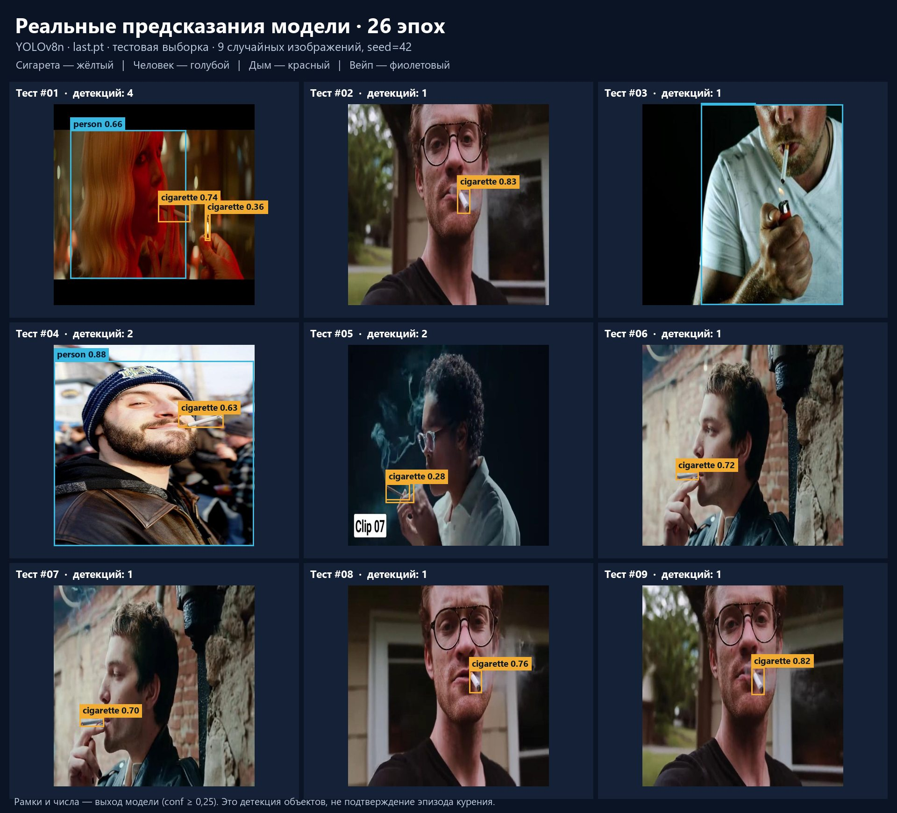
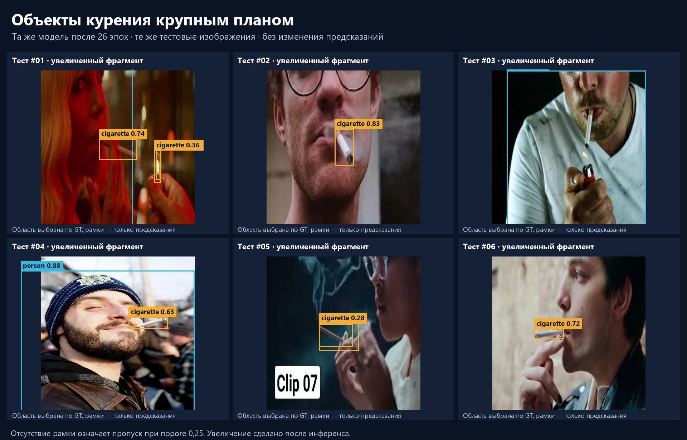

# GreatHanDetect — видеоаналитика на LinQ TPU

Прототип для хакатона: **видео → нейросеть → трекинг → временное правило → доказательство → журнал → оператор**. Поддерживаются удалённый LinQ через AMQP, локальный ONNX Runtime и явно обозначенный тестовый replay.

[Все документы](docs/README.md) · [Статус](docs/BUILD_STATUS.md) · [Инструкция оператора](docs/APPLICATION_RU.md) · [Развёртывание](docs/DEPLOYMENT_RU.md) · [Отчёт](docs/INTERMEDIATE_REPORT_RU.md)

## Что действительно работает

| Возможность | Состояние на 24.10.2026 |
|---|---|
| Человек в опасной зоне | Проверена вся цепочка с реальным LinQ, доказательством и журналом |
| Детекция объектов + поза + правило курения | Реализованы; качество курения на TPU пока не принято |
| Обученная YOLOv8n | Checkpoint после 26 эпох; реальные предсказания на тестовых изображениях |
| Обученный checkpoint в приложении / на TPU | Пока не подключён / не проверен |
| Каска, жилет, падение | Только DEMO; модели не подключены |
| Точность на производственном видео | Не измерена: настоящие ролики пока не предоставлены |

В интерфейсе доступны источник и полигон зоны, кадры-доказательства, журнал с фильтрами, решения оператора, CSV, уведомления и диагностика. История сохраняется в SQLite. Повторные кадры одного эпизода не создают новые оповещения.

## Быстрый запуск без весов и VPN

Требуются Git и Python 3.12. Команды выполняются из корня репозитория.

```powershell
git clone https://github.com/Noizicrafty/GreatHanDetect.git
cd GreatHanDetect
.\setup_application_windows.bat
.venv\Scripts\python.exe tools\make_app_demo.py
.\START_APPLICATION_WINDOWS.bat --config assets/demo/replay_config.json --data results/qa
```

Linux:

```bash
bash setup_application.sh
.venv/bin/python tools/make_app_demo.py
bash start_application.sh --config assets/demo/replay_config.json --data results/qa
```

Открыть **http://127.0.0.1:8080/** и нажать запуск. Это проверка приложения на подготовленных детекциях, помеченная REPLAY. Она не доказывает работу модели.

## Запуск настоящей модели

1. Получить отдельно ONNX и, для LinQ, `.tpu` согласно [реестру моделей](docs/MODEL_REGISTRY_RU.md). Бинарники в Git не включены.
2. Для зоны использовать `configs/application.yaml` (CPU) или `configs/danger_zone_linq.yaml` (LinQ). Задать свой путь видео в `camera.source` и проверить полигон.
3. Для LinQ подключить VPN, установить codec wheel организаторов, задать данные брокера в переменных окружения и проверить серверный путь `.tpu`.
4. Сначала проверить изображение через `tools/check_model.py`, затем видео через консоль. [Команды и диагностика](docs/DEPLOYMENT_RU.md).

`configs/smoking_onnx_cpu.yaml` и `configs/smoking_world_experimental.yaml` предназначены для инженерной проверки. У квантованной YOLO-World обнаружено ухудшение против CPU; успешное исполнение не означает принятое качество.

## Реальные предсказания обученной модели

`last.pt` содержит **26 завершённых эпох** (`epoch=25` в checkpoint). Инференс выполнен локально через PyTorch, без обучения. Девять тестовых изображений выбраны с seed=42. Примеры включают пропуск сигареты.





Числа на рамках — confidence, а не процент точности. Фотография с сигаретой ещё не подтверждает эпизод курения. [Происхождение и воспроизведение](docs/TRAINED_MODEL_RESULTS_RU.md).

## Проверенные измерения

Короткий реальный LinQ-прогон: 23 кадра, 4 события, p95 клиентского инференса **1,208 с**; p95 от подтверждающего кадра до подтверждения показа интерфейсом **1,183 с**. Десятиминутный прогон: 299 кадров при заданных 0,5 кадра/с, p95 инференса **1,731 с**. Это повторяющиеся фотографии, измерение транспорта и приложения, не точность CCTV или максимум TPU. [Подробный отчёт](docs/INTERMEDIATE_REPORT_RU.md).

## Проверки и следующие шаги

```bash
python -m pip install -r requirements/runtime.txt
python tools/bootstrap_source.py
python -m compileall -q greathan tools tests
python -m unittest discover -s tests -v
```

Локально пройдены **59 тестов** транспорта, временных эпизодов, журнала, HTTP, доказательств, трекинга, данных и оценки. GitHub Actions проверяет проект отдельно на Linux. Тесты не измеряют точность нейросетей.

Обучение сейчас остановлено; установка и демонстрация его не запускают. [Необязательное обучение](docs/TRAINING_RU.md) описано для будущей работы. До сдачи: довести курение на готовых весах, проверить настоящие ролики, повторить длительный тест, собрать комплект моделей. [Чек-лист](docs/ACCEPTANCE_CHECKLIST.md).

## Сторонние материалы

[clyv/smoking-detection](https://github.com/clyv/smoking-detection) загружается в фиксированной версии. Фотографии: [Richie Lab, smoking-tasfx v4](https://universe.roboflow.com/richie-lab/smoking-tasfx/dataset/4), CC BY 4.0 по экспорту. [PaddleDetection](https://github.com/PaddlePaddle/PaddleDetection) — возможный источник будущих моделей; его модели сейчас не исполняются. [Лицензионные сведения](docs/THIRD_PARTY_NOTICES.md).
